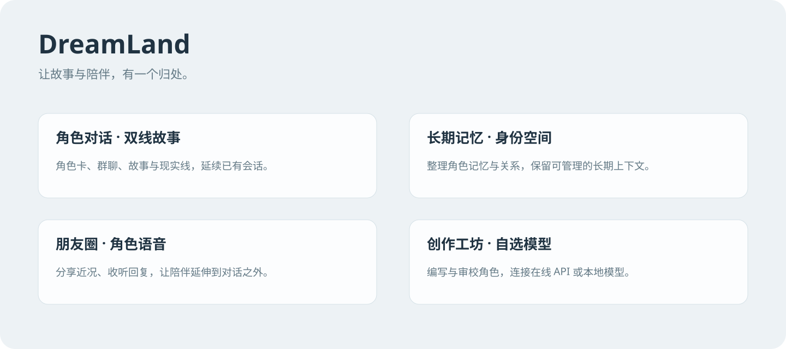

# DreamLand

让故事与陪伴，有一个归处。原 LeslieTavern，现统一使用 DreamLand 品牌。




界面统一采用 **MomoTalk · 蔚蓝档案** 的布局和控件规范，固定默认红色强调，按钮与导航使用统一游戏 UI 部件。亮暗、首页场景与聊天背景按用户空间保存并同步到登录页，旧偏好自动迁移。功能页使用完整主区域，手机保留双线聊天入口。57 张运行图片直接随项目保存在 `public/img/blue-archive/bundled/`，无需额外安装；便携构建会校验并携带完整素材。修复工具见[素材说明](public/img/blue-archive/ASSETS.md)，后续开发素材见[UI 素材库](resources/blue-archive/README.md)，详见[界面与素材说明](docs/dreamland-appearance.md)。

[English](README.en.md) | 简体中文

[](https://github.com/LeslieH666/LeslieTavern/actions/workflows/ci.yml)
[](LICENSE)

DreamLand 是基于 [SillyTavern](https://github.com/SillyTavern/SillyTavern) 开发的实验性桌面聊天分支。SillyTavern 的聊天、角色卡、群聊、World Info、Swipe、模型适配和 JSONL 存储仍是权威核心；Leslie 功能以可选扩展和服务形式叠加，普通聊天在这些功能不可用时仍应保持可用。

本仓库只维护 DreamLand 一个应用。`src/leslie-bridge/` 是默认关闭、进程令牌保护的接口层，作为后续 `/api/v1` 的种子。

> 当前处于可运行原型阶段，不是 SillyTavern 官方版本，也不是经过签名的正式发行版。

## 主要功能

- 保留 SillyTavern 的角色卡、群聊、World Info、Swipe、模型适配和 JSONL 聊天格式。
- 提供 Windows Electron 桌面入口、单一 `DreamLand` 启动入口和便携构建脚本。
- 提供初版 Android 手机/平板客户端 APK：连接同一可信局域网中的电脑 DreamLand；聊天与角色数据继续保存在电脑，模型由电脑端连接，客户端不管理也不托管模型。构建方法见 [Android 客户端说明](mobile/README.md)。
- 提供 Android 独立运行 Beta：Node.js 服务在手机应用进程内启动，角色与聊天数据保存在手机应用私有目录；此版本面向 arm64 测试，模型连接需要用户手动指向云端或自托管接口，应用不托管模型。构建方法见 [Android 客户端说明](mobile/README.md)。
- 提供 Leslie 身份、Persona / 剧情线隔离，以及彼此可产生少量记忆共鸣的故事线与现实线聊天。现实线只提取去剧情核心性格，由当前 API 动态生成开场，并严格保存为普通即时消息；朋友圈另有桌面双栏布局、真实已读、连续评论回复、可查看点赞名单、按角色授权主动发帖、独立记忆和托盘后台运行。
- 提供火山引擎角色语音配置、试听与回复自动朗读。
- 提供可选的互动引导输入：围绕当前用户 Persona 生成三个可点击回复，并回到原有聊天生成链路；故事线单角色聊天还可使用“剧情罗盘”生成三个跨场景、跨阶段且具有长期影响的主线篇章、可选轮数建议，并把用户采用的主线固定在聊天界面。手机端使用独立标题条和底部抽屉查看主线，不占用聊天头部按钮空间。
- 提供 AI 角色工坊：可使用当前聊天 API（包括 DeepSeek 等）或手动连接的 OpenAI-compatible 接口生成 CCV3 草稿；结果只在内存中预览，用户明确应用后才进入角色编辑器。
- 可通过原有的 KoboldCpp 与 OpenAI-compatible 适配器手动连接已经运行的自托管或远程接口；本仓库不附带、不启动也不管理模型运行时，模型权重、推理程序和运行日志都不进入 Git。
- 在线 API 密钥按账号和服务商保存；切换接口后可直接复用，Windows 上的本地密钥文件使用当前用户的 DPAPI 加密。
- 提供默认关闭、进程令牌保护的 Leslie Bridge v1（`/health`、`/capabilities`、`/model/chat/completions`、`/voices`、`/models`、`/audio/speech`），作为后续 `/api/v1` 的种子。
- 将源码、运行时、用户数据和分发包明确分离，避免私人聊天进入 Git。

## 快速开始

### 开发环境

要求 Node.js 20 或更高版本、npm 和 Git。

```bash
git clone https://github.com/LeslieH666/LeslieTavern.git
cd LeslieTavern
npm ci
npm ci --prefix src/electron
npm run start
```

浏览器服务启动后默认使用本机地址。需要 Electron 桌面壳时运行：

```bash
npm run start:electron
```

如需运行完整仓库校验：

```bash
npm ci --prefix tests
npm run validate
```

`validate` 会依次执行仓库边界检查、DreamLand 源码 lint、测试目录 lint 和单元测试。端到端测试需要单独启动服务：

```bash
npm run test:e2e --prefix tests
```

### 已整理的本机工作区

本项目只保留一个日常启动入口：

- `启动 DreamLand.cmd`：启动 DreamLand 桌面端。
- `备份用户数据.cmd`
- `打开用户数据目录.cmd`
- `查看运行日志.cmd`

启动后可在“设置 → 模型连接”中手动连接已经运行的自托管或远程 KoboldCpp / OpenAI-compatible 接口。脚本和服务使用项目根目录下的本地 `data/`、`Runtime/`、`Config/` 与 `Run/`；这些目录不会进入 Git。
启用局域网监听后，与访问地址属于同一私有子网的设备无需逐个填写 IP；切换家庭 Wi-Fi 或手机热点后会自动使用新子网，公网及未用于当前连接的其他网段仍被拒绝。

### 角色工坊

角色工坊的“角色卡生成接口”可以使用当前聊天 API，或使用手动连接的自托管 OpenAI-compatible / KoboldCpp 接口。DreamLand 不打包、不启动也不管理推理运行时；需要时请自行运行 KoboldCpp、llama.cpp 等兼容服务，再在“设置 → 模型连接”中填入地址。地址和端口调整、Ollama、llama.cpp、其它格式及自行启动的服务都保留在“展开高级连接设置”中。

使用流程：

1. 打开“AI 角色工坊”，在“角色卡生成接口”中选择当前聊天 API 或已连接的接口。
2. 检查简报、知识核对、JSON 草稿和质量审校；预览不会自动写入角色目录。
3. 只有点击“带入角色编辑器”并在原有编辑流程中保存，才会创建正式角色卡。
4. 也可以在“手动创建”的二级界面中选择标准 JSON 角色卡和头像，点击“导入并填充创建表单”，确认字段后使用原有“创建角色”按钮保存。

生成内容是否遵循某条内容约束取决于模型权重、推理运行时和当前提示词；项目不把“无限制”作为稳定性或安全性保证。角色工坊的接口只负责本次草稿生成，不会替换全局聊天 API 设置。

角色记忆的“自动整理”也支持独立模型分层：打开角色记忆面板的“设置与安全”，在“记忆整理模型”中选择跟随聊天 API、DeepSeek API、KoboldCpp / llama.cpp，或独立 OpenAI-compatible 接口。DeepSeek 选项使用与聊天 API 相同的 OpenAI Chat Completions 格式；该选择按每个角色记忆档案保存，记忆抽取和成长整理不会改变角色正常聊天的模型设置；旧版记忆档案会自动迁移并保留迁移前备份。

### 在线 API 密钥

在“设置 → 模型连接”输入在线接口密钥后，点击连接或切换接口就会保存到该账号的本机密钥库。切换回来时显示已保存状态，留空即可复用；密钥明文不会回填到输入框或浏览器本地存储。Windows 运行方式使用当前系统用户的 DPAPI 加密 `secrets.json`，旧版明文密钥文件在读取时原位迁移；加密失败时保留原文件。旧版留下的历史备份不会自动改写，仍需按明文密钥文件妥善保管。密钥文件随账号和电脑绑定，移到另一台电脑或 Windows 用户下需重新输入。其他操作系统继续使用原有的本机密钥文件格式。

## 项目结构

```text
LeslieTavern/
├─ .github/        GitHub Issue、PR 与 CI 配置
├─ docs/           架构、路线图、设计和数据说明
├─ packaging/      Windows 本机与便携版脚本
├─ public/         浏览器端界面与扩展
│  ├─ scripts/leslie-character-workshop/
│  ├─ scripts/leslie-character-import*.js
│  └─ scripts/leslie-story-choices.js
├─ scripts/        仓库维护和数据迁移工具
├─ src/            服务端、Electron、Bridge 与 Leslie 模块
│  ├─ electron/    Electron 主进程和桌面入口
│  ├─ leslie-bridge/
│  ├─ leslie-identity/
│  ├─ leslie-memory/
│  ├─ leslie-moments/
│  └─ leslie-tts/
├─ tests/          单元测试与端到端测试
├─ mobile/         Android 手机/平板客户端与可复用共享模块
├─ data/           本地用户数据，仅保留占位文件进入 Git
└─ README.md       项目入口
```

核心边界可以概括为：

```text
SillyTavern chat engine
├─ Leslie UI extensions
│  ├─ identity / memory / moments / voice
│  ├─ story choices
│  └─ character workshop providers
├─ Existing model adapters
└─ Optional Leslie Bridge v1
   ├─ Process-scoped bearer token
   └─ /health, /capabilities, /model/chat/completions, /voices, /models, /audio/speech
```

Leslie Bridge v1 默认关闭，只提供 `/health`、`/capabilities`、`/model/chat/completions`、`/voices`、`/models` 与 `/audio/speech`，是后续 `/api/v1` 的种子。DreamLand 自己负责提示词组装、角色与聊天状态、记忆、模型连接和持久化。

## 用户数据与隐私

在“设置 → 用户空间”中，电脑本机的管理员可以为默认用户设置密码并启用多用户空间。首次启用会将原有聊天、角色、演示数据及项目根目录的旧备份迁入密码保护的加密空间，并保留一份加密的初始回退副本。之后可在设置中创建更多用户，并通过“切换用户”回到选择页。正常退出或登出会重新封存当前空间；密码丢失后无法解密该空间。异常断电或强制结束进程可能留下运行中的明文工作目录，重新登录会尝试封存并恢复它。

界面风格、明暗、配色、语言和交互偏好会随各自用户空间保存，演示空间的设置独立保存。登录页显示已保存的主题；未登录时只读取外观白名单，不读取聊天或其他设置。登录解密使用异步文件处理并显示进度，封存会等待正在完成的文件任务。演示模式提供独立的虚构角色、双线聊天、朋友圈、记忆成长和关系分数示例；已有演示空间再次进入时会补充这些示例，后续修改不会被重置。

角色卡、聊天、密钥、记忆、语音配置、日志、缓存、备份和本地运行时均被 `.gitignore` 排除。提交或报告问题前请运行：

```bash
npm run check:repo
```

不要在 Issue、Pull Request、日志或截图中附带聊天正文、角色文件、API 密钥或其他私人数据。详见 [数据与打包说明](docs/data-and-packaging.md) 和 [安全策略](SECURITY.md)。

## 文档

- [项目概览](docs/project-overview.md)
- [开发路线图](docs/roadmap.md)
- [界面设计基线](docs/design.md)
- [Cupertino UI 重构与回退说明](docs/cupertino-ui-refactor.md)
- [角色卡工作流](docs/character-card-workflow.md)
- [数据与打包说明](docs/data-and-packaging.md)
- [贡献指南](CONTRIBUTING.md)
- [变更记录](CHANGELOG.md)

## 上游与许可证

DreamLand 是 SillyTavern 的衍生项目，并非官方发行版。上游项目及原作者保留其各自权利；衍生代码继续采用 [GNU AGPL-3.0](LICENSE) 许可证。网络部署和修改版本分发同样需要遵守 AGPL-3.0。
